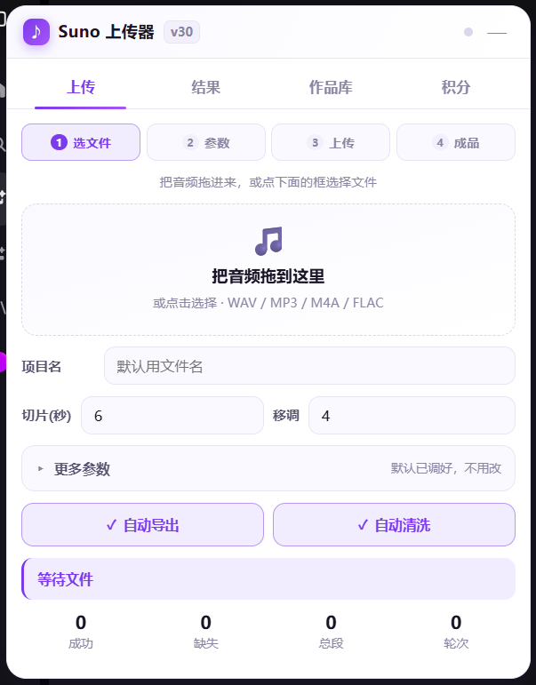
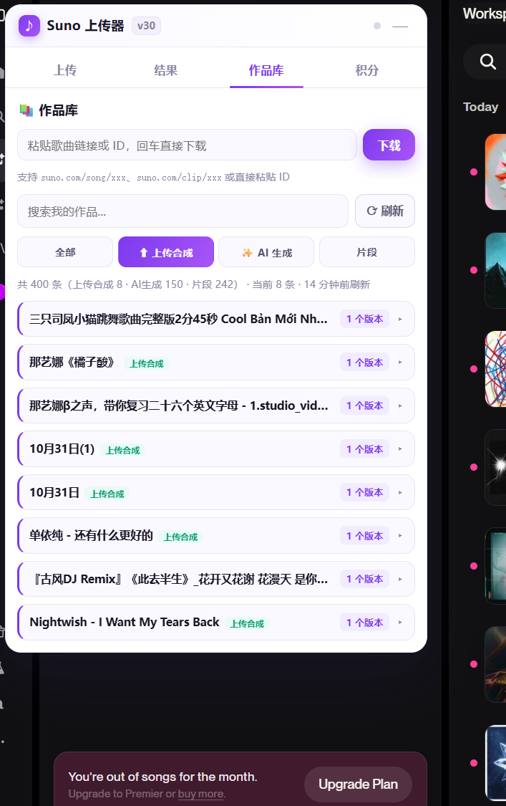
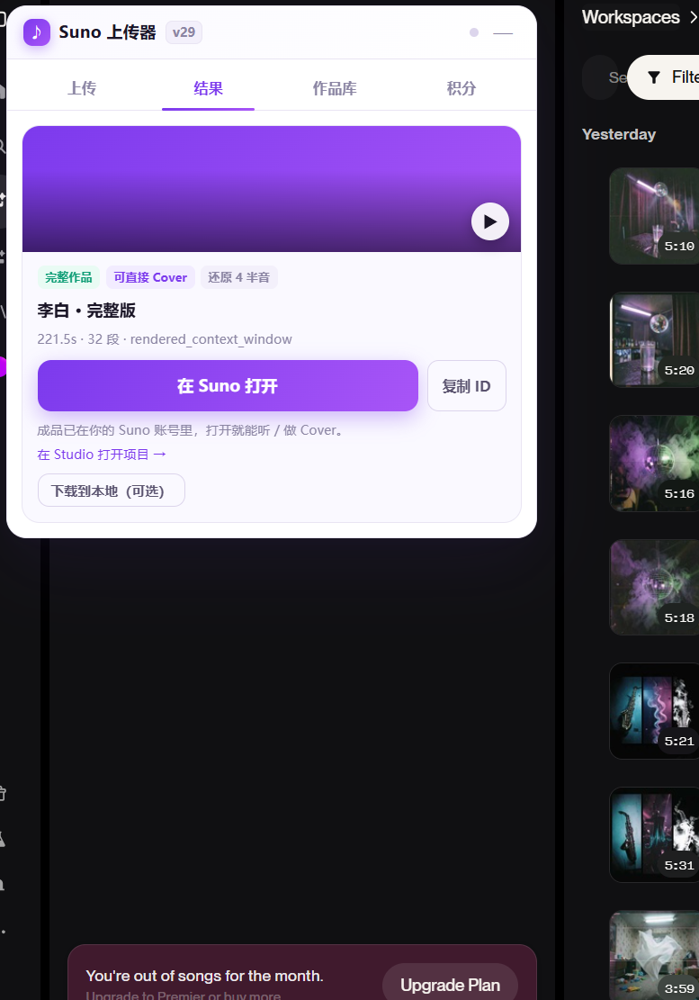

# Suno 一键上传器

**干一件事：把你电脑里的音频塞进 Suno，自动切成小段传上去，在 Studio 里拼回一整首歌。**

现场录音、手机录的小样、自己混好的成品、伴奏 —— 只要你的播放器能放，它就能处理。

> 单文件用户脚本。不用装 Node，不用敲命令，不用注册账号，不用改配置。装个浏览器插件、点两下就开始干活。



## 它替你省掉了哪些手工活

Suno 一次只收很短的一小段，一首三分半的歌得切成三十多段。手工流程是：先切好三十个文件 → 一段段点上传 → 等每段生成 → 在 Studio 时间线上把三十段按顺序拖到位置上。一首歌下来手指是废的。

这个脚本把整套流程压成三步：**拖进去 → 点「开始上传」→ 等结果。**

- **自动切段**：按 6 秒切。不是因为好看，是因为 Suno 最短只收 6 秒，切短了它会在开头补静音，拼起来整首歌就往后错位。
- **批量上传**：6 段一起传。失败的那段自动换参数重试，还漏就二分补漏；补不到就明说缺第几段，绝不给你一首中间有洞的歌。
- **断点续传**：进度存在本地，关掉页面、刷新、明天再来，它只补没传完的部分。
- **自动收尾**：传完自动建工程、排时间线、导出，结果页直接点开成品。
- **顺手带个作品库**：粘链接或搜歌名，把自己账号里的成品下载回来。



## 装（三分钟，照做就行）

**第 1 步 · 装 Tampermonkey（篡改猴）**

Edge 打开 [Edge 加载项](https://microsoftedge.microsoft.com/addons) 搜「Tampermonkey」，Chrome 打开 [Chrome 应用商店](https://chromewebstore.google.com/) 搜同名，点「获取」→「添加扩展」。

**第 2 步 · 装这个脚本**

**点这个链接就能装：** https://raw.githubusercontent.com/diyiritian-ops/suno-uploader/main/src/Suno-OneClick-Uploader.user.js

（Tampermonkey 会自己弹安装页。装好之后它会跟着 main 分支自动检查更新。）

（Tampermonkey 会自己弹一个安装页，上面有个绿色「安装」按钮，点它就行。）

**第 3 步 · 打开 suno.com 登录，然后按一下 F5**

不刷新的话脚本挂不上去 —— 这一步跳过的人最多，也最容易被误判成「装了没用」。

**第 4 步 · 看右下角**

出现一个紫色小圆球，就是装好了。点开它就是面板。

### 装完没反应？十有八九是这一个开关

Edge 上 Tampermonkey 有个总开关**默认是关的**：地址栏敲 `edge://extensions` → 找到「篡改猴 / Tampermonkey」→ 点「详细信息」→ 把 **「允许用户脚本」** 打开 → 回 suno.com 刷新。

Chrome 没这个开关，不用管。

还没有圆球的话，按顺序排查：① 地址真的是 `suno.com` 吗（不是套壳站、不是 `suno.ai`）；② Tampermonkey 图标里这个脚本是「启用」状态吗；③ 按 `Ctrl + Shift + R` 强刷一次。

## 用（四步，参数不用动）

| 第 1 步 | 第 2 步 | 第 3 步 | 第 4 步 |
|---|---|---|---|
| 把音频拖进面板 | 参数不用改 | 点「开始上传」 | 结果页点「在 Suno 打开」 |

1. **拖文件**：拖到面板任何位置都行。mp3 / wav / m4a / flac 都吃，拖进去它自己解码、自己算要切几段。
2. **参数**：默认值就是调好的，直接下一步。
3. **开始上传**：进度条右边会写「还剩约 X 分 Y 秒」，去泡杯茶。**别关这个标签页**，后台标签会被浏览器暂停。
4. **成品**：跑完自动跳结果页，封面、标题、时长都在那儿。点「在 Suno 打开」就是那首歌，可以直接做 Cover。



## 三个参数，想动再看

| 参数 | 默认 | 人话解释 |
|---|---|---|
| 切片 | 6 秒 | Suno 只收 6 秒以上。切 6 秒段数最多、单段失败损失最小；切大一点传得快，但一段出错丢的内容也多。 |
| 移调 | +4 | 把音高整体挪 4 个半音。听起来还是那首歌，但和原文件已经不是同一份波形了 —— 同一批素材反复上传时，能少踩「这歌我听过」的坑。超过 +7 耳朵能明显听出发闷。 |
| 并发 | 6 | 同时传几段。网好就 6，被限流就降到 3。 |

## 出问题怎么办（对号入座）

| 症状 | 原因 | 怎么办 |
|---|---|---|
| 右下角没有紫色圆球 | 脚本根本没跑起来 | ① 按 F5；② Edge 上检查「允许用户脚本」开关；③ Tampermonkey 图标里确认脚本是启用状态 |
| 面板跑到屏幕外面了 | 换过窗口大小或分辨率 | Tampermonkey 图标 →「重置面板位置（看不见面板时用）」 |
| 一点开始上传全是红的 | 没登录，或者登录过期了 | 回 suno.com 重新登录 → 刷新 → 再来一次 |
| 卡在某一段不动 | 网络抖动，被限流了 | 它会自己重试；卡太久就点暂停再继续，或者把并发降到 3 |
| 提示缺第 N 段 | 那一段反复失败 | 点「只补缺的 N 段」，只重跑缺的，前面传好的不白费 |
| 结果页「导出」点不动 | 有缺段 | 这是故意的 —— 有洞的成品不如不要。先补段 |
| 下载卡住不动 | 格式选了 MP3，编码器要从国外 CDN 拉 31 MB | 格式改 **M4A**（就是原文件，几秒出）。MP3 首次要下编码器，网不好会等到你怀疑人生 |
| 听歌赚积分那页不动 | 标签页在后台 | 别最小化窗口，Suno 会暂停后台标签页的播放 |
| 刷新后进度没了 | 换过浏览器或清过扩展数据 | 进度存在 Tampermonkey 里，清掉就没了 |

还是搞不定，开个 issue：写清「第几步、什么现象、浏览器和版本」，有截图最好。

## 它不碰的东西

- **不碰你的密码**。它读的是你手动登录之后浏览器里的登录状态，仅此而已。
- **不上传你没选的文件**，不扫你硬盘。
- **不把数据发给第三方**。只有两处联网：传到你自己账号的 Suno；下载 MP3 时从公共 CDN（jsDelivr）取编码器。选 M4A 就完全不碰 CDN。
- **不改你的账号设置**。

## 常见疑问

**会不会被平台处理？**
它做的事和你自己用手点一模一样，只是快。真正招麻烦的是「量」：并发开到 20、一天传几百首，任何平台都会当成异常流量。正常节奏（一次一首、一天几首）没这个问题。

**传上去的东西版权算谁的？**
和你手动上传完全一样，按 Suno 的规则走。请只传你有权处理的内容。

**为什么非要切 6 秒？**
Suno 单次上传有最短时长要求。短于 6 秒它会在开头补静音，拼接就整体错位。所以切片不是玄学，是为了时间线能对得上。

**手机上能用吗？**
不能。脚本跑在桌面浏览器的 Tampermonkey 里，手机浏览器装不了。

**Suno 改版了还能用吗？**
接口一改就会失效，这不是 bug。到 issue 说一声，或者等更新。

**为什么不直接做个网站？**
上传要借用你自己的登录状态和本机文件，本地脚本是最轻的做法 —— 中间没有别人的服务器，你的歌不会先传到谁家机器上。

**会不会偷偷下载东西？**
不会自动下载。v30 起跑完只跳到结果页，要下载才有下载。

## 卸载

Tampermonkey 图标 →「管理面板」→ 找到这个脚本 → 删除。本地存的进度和配置一起清掉，不留垃圾。

## 开发

```bash
node tools/cdp-proxy.mjs --port 3456 --cdp-port 9222   # 本地 CDP 调试代理
node tools/serve.mjs ./dist 3457                       # 把 .user.js 喂给 Tampermonkey
```

- `docs/quick-start.md` —— 30 秒上手
- `docs/usage.md` —— 完整说明，每个按钮都写到
- `docs/tech-notes.md` —— 接口、字段、踩坑记录

## 免责声明

- 本项目用于**个人音频管理与学习研究**。请确保你对上传的内容拥有权利。
- 使用本工具需遵守 Suno 的服务条款与你所在地的法律法规；账号状态、内容审核等后果由使用者自己承担。
- 平台接口随时可能变更，不保证长期可用。

## License

[MIT](LICENSE)
